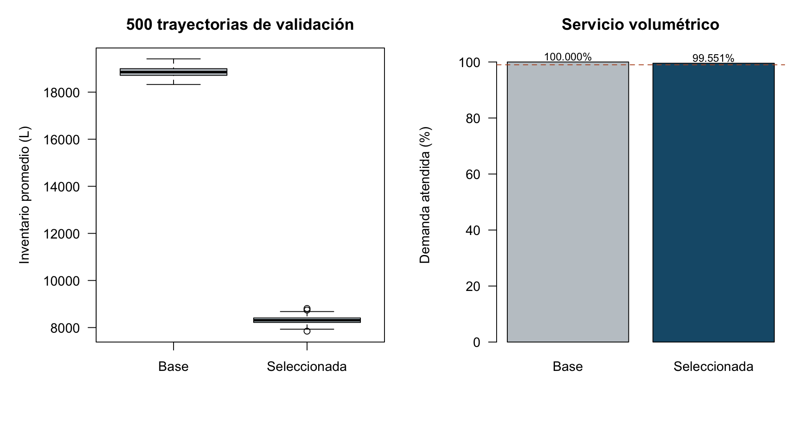

# Fuel Inventory Optimization with R and MiniZinc

Academic data science project by Andrew Alexander Arrivillaga Arana. A stochastic simulation and constrained policy selection study for a hypothetical fuel station, using historical UK petrol sales data.

## Objective

Reduce average fuel inventory while maintaining a volume-based service level of at least 99%. Compare periodic-review `(s, S)` replenishment policies under uncertain daily demand.

## Methodology

- Process 731 daily observations from 2024–2025 in R. Use 2024 to generate demand scenarios and reserve 2025 for historical evaluation without retuning.
- Generate stochastic demand by sampling historical sales with replacement within each weekday.
- Evaluate 36 candidate policies over 100 simulated trajectories; validate three finalists using 500 new trajectories, each with a 28-day warm-up and 91 measured days.
- Estimate approximate 95% Monte Carlo confidence intervals, compare the selected policy against the baseline, and evaluate sensitivity to delivery lead time and a 20% increase in demand.
- Use MiniZinc/Gecode to select the minimum-inventory feasible candidate from the three policies already evaluated in R.
- Check inventory balance, capacity, lost sales and reproducibility using test scripts and fixed seeds.

## Results

| Metric (500-trajectory validation) | Baseline | Selected |
| --- | ---: | ---: |
| Reorder threshold (L) | 14,000 | 7,000 |
| Order-up-to level (L) | 27,900 | 14,000 |
| Average inventory (L) | 18,853 | 8,313 |
| Volume-based service level | 100% | 99.55% |
| Average orders per 91 days | 35.97 | 60.38 |

The selected policy reduced simulated average inventory by **55.91%**. The historical 2025 evaluation achieved **99.83%** service over 337 measured days. With a two-day delivery lead time, simulated service fell to **73.90%**, indicating substantial lead-time sensitivity.



These are simulated results, not measured savings or a production deployment. More frequent deliveries may offset inventory benefits. The model does not include order costs, minimum order sizes or truck constraints. The source describes average UK station sales, not individual station demand; sales may understate unmet demand. The confidence intervals describe simulation error conditional on the model assumptions, not all real-world uncertainty.

## Reproduce

Prerequisites: R (original run: 4.4.3), `readxl`, `jsonlite`; optional MiniZinc and Gecode (original run: MiniZinc 2.11.0).

From the repository root, install dependencies in R:

```r
install.packages(c("readxl", "jsonlite"))
```

Run:

```sh
Rscript codigo/verificar.R
Rscript codigo/ejecutar.R
Rscript codigo/verificar_resultados.R
# Optional: requires MiniZinc and Gecode
Rscript codigo/ejecutar_minizinc.R
```

The main script downloads the exact original Excel file if it is absent. Internet access is required on the first run unless the original is placed at `datos/original_desnz.xlsx`. The processed CSV and original saved results are included. If MiniZinc is not on PATH, set the `MINIZINC` environment variable to its executable path. Running the main script regenerates results and resets the MiniZinc status until its separate script is run.

## Repository structure

- `codigo/`: original R simulation, analysis, checks and MiniZinc integration.
- `datos/`: processed daily sales data and source attribution.
- `minizinc/`: selection model, candidate data and saved solver output.
- `resultados/`: saved metrics, scenario comparisons, traces, figures and R session information.

The original R implementation and outputs are in Spanish. This README describes their scope in English for portfolio use.

## Data source

UK Department for Energy Security and Net Zero (DESNZ), *Average road fuel sales, deliveries and stock levels*, 8 October 2026 edition. Sheet `Main table - sales`, petrol, United Kingdom column, litres. [Official series](https://www.gov.uk/government/statistics/average-road-fuel-sales-and-stock-levels).

Contains public sector information licensed under the [Open Government Licence v3.0](https://www.nationalarchives.gov.uk/doc/open-government-licence/version/3/). See `datos/README.md` for exact source and checksum.
